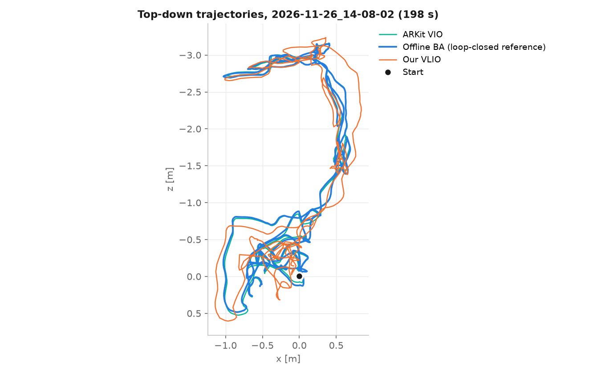
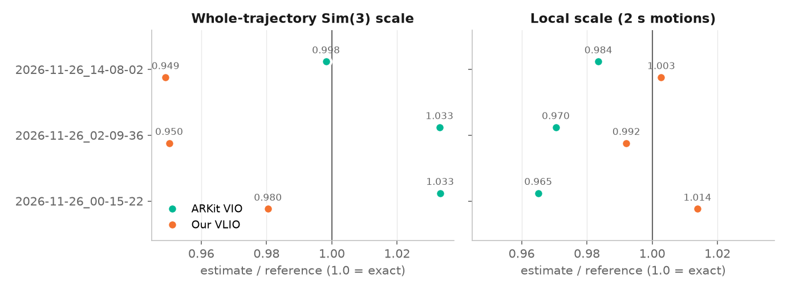

# pocket-slam-ios

Visual–LiDAR–inertial SLAM on an iPhone 15 Pro, built **without a Mac**: the iOS app is compiled and
installed from Windows (WSL2) with [xtool](https://github.com/xtool-org/xtool).

The app records synchronised camera, LiDAR and IMU data and runs its own **tightly coupled sliding-window
VLIO** (camera + LiDAR + raw IMU in one factor graph, shared C++ core) on the phone after each scan.
ARKit runs alongside as a live reference, and an offline loop-closed bundle adjustment serves as the
accuracy reference.

<p align="center"></p>

## What is in here

| Folder | What |
|---|---|
| [`App/`](App/) | iOS app (SwiftUI + ARKit + RealityKit), SwiftPM package built by xtool |
| [`core/`](core/) | **shared C++17 VLIO core** (Eigen only): KLT front end, IMU preintegration, sliding-window LM with marginalisation, LiDAR depth factors; C API for Swift / JNI; Linux runner + tests |
| [`tools/`](tools/) | Python: recording inspector, offline bundle adjustment + TSDF meshing (GTSAM, Open3D), evaluation, figures, 3D viewer |
| [`scripts/`](scripts/) | WSL / Windows setup and iPhone connection scripts |
| [`docs/`](docs/) | [setup](docs/SETUP.md) · [findings](docs/FINDINGS.md) · [troubleshooting](docs/TROUBLESHOOTING.md) · [data format](docs/DATA_FORMAT.md) · figures · metrics |

## How it works

```
 SCAN (online, light)                            AFTER STOP (on device, full precision)
 ─────────────────────                           ──────────────────────────────────────
 ARKit 1920x1440 @ 60 fps ─┐                     ring of 3 frame slots, 3 overlapping stages:
 LiDAR 256x192 + conf ─────┼─► raw recording ──► 1 GPU  Core Image: JPEG/PNG decode, luma, LiDAR,
 IMU 100 Hz (CoreMotion) ──┘   (pooled buffers,         RGB-aligned depth (edge-preserving upsample)
 ARKit poses (reference)        batched writes)  2 CPU  C++ VLIO core, strictly in order
 optional live VLIO preview                      3 I/O  depth PNGs streamed to disk
```

* **Online**: only raw sensor data is stored (no per-frame heap allocation, pooled buffers, batched CSV
  writes, 60 fps capture), so the phone stays in the *nominal* thermal state while scanning.
* **After the scan**: processing starts automatically at `.userInitiated` QoS, pauses while you scan,
  survives backgrounding (`beginBackgroundTask`), and auto-saves at the *critical* thermal state.
* **VLIO core**: state per keyframe (R, p, v, b_a, b_g), inverse-depth landmarks, IMU preintegration
  (Forster et al.), reprojection + LiDAR depth factors (only where the LiDAR is locally flat), 10-keyframe
  window, oldest keyframe marginalised into a linear prior (Schur complement). Metric scale comes from
  LiDAR, so no visual-inertial scale initialisation is needed.

## Results (summary)

Reference = offline loop-closed bundle adjustment of the same recording (see [FINDINGS](docs/FINDINGS.md)).

| Recording | Length | Source | ATE | Local scale (2 s) | LiDAR consistency, revisits |
|---|---|---|---|---|---|
| 2026-11-26_15-59-37 | 249 s, 35.5 m | ARKit VIO | **4.6 cm** | 0.983 | 31.4 mm |
| | | Our VLIO (odometry only) | 10.5 cm | 1.004 | 54.2 mm |
| | | **Our SLAM** (VLIO + loop closure) | 4.9 cm | **0.999** | **9.9 mm** |
| 2026-11-26_14-08-02 | 198 s, 33.9 m | ARKit VIO | **2.9 cm** | 0.984 | **11.0 mm** |
| | | Our VLIO (odometry only) | 37.0 cm | 1.009 | 58.7 mm |
| | | **Our SLAM** (VLIO + loop closure) | 11.0 cm | **1.002** | 15.9 mm |
| 2026-11-26_00-15-22 | 85 s, 10.9 m | ARKit VIO | 4.5 cm | 0.965 | 23.1 mm |
| | | Our VLIO (odometry only) | 5.9 cm | 1.018 | 49.2 mm |
| | | **Our SLAM** (VLIO + loop closure) | **3.1 cm** | **1.013** | **14.9 mm** |

* **Local metric accuracy**: our VLIO measures short motions to within 0.1–1.8 % (ARKit: 1.6–3.5 % short).
* **Global accuracy**: odometry alone is limited by **heading drift** (2–8°). Post-scan **loop closure**
  (LiDAR-verified revisits + 4-DoF pose graph) removes most of it: ATE below ARKit on the 85 s scan and within
  0.3 cm of it on the 249 s scan, and revisited surfaces line up 1.5–3x better than ARKit's on both.
* **Synthetic ground truth** (`core/tests`): 9.4 mm RMSE over 4.8 m, 0.32° max rotation error, biases recovered.

<p align="center"></p>

## Quick start

Full, reproducible instructions (versions, every command, expected output): **[docs/SETUP.md](docs/SETUP.md)**.

```bash
# --- once, in WSL Ubuntu 24.04 ---
sudo bash scripts/wsl_install_system.sh        # usbmuxd, libimobiledevice, Swift deps
bash scripts/wsl_install_user.sh               # Swift 6.4.3 (swiftly) + xtool 1.24.0
source ~/.bashrc
xtool setup                                    # Apple ID + Xcode 27.1 .xip -> iOS SDK

# --- every session (iPhone plugged in, Apple Devices open on Windows) ---
#   Windows, admin PowerShell:  .\scripts\windows_usbmux_bridge.ps1   (after each reboot)
source scripts/wsl_use_windows_usbmux.sh
xdevices                                       # = xtool devices --usb
xdev                                           # = build (release) + sign + install + launch
```

On the phone: **Settings → Privacy & Security → Developer Mode** on, and after the first install
**Settings → General → VPN & Device Management → your Apple ID → Trust**. A free Apple ID works
(apps expire after 7 days; run `xdev` again).

Analyse a recording on the PC (copy it off the phone via the Files app / Apple Devices):

```bash
bash tools/setup_env.sh && source ~/venvs/slamtogo/bin/activate
python tools/inspect_recording.py <rec>        # sanity checks
python tools/run_ba.py <rec>                   # offline BA reference + TSDF meshes
python tools/eval_trajectories.py <rec>        # ARKit vs BA vs our VLIO
python tools/view_reconstruction.py <rec>      # 3D viewer (WSLg)
```

## Tested with

Windows 11 + WSL2 Ubuntu 24.04 · Swift 6.4.3 (swiftly) · xtool 1.24.0 · Xcode 27.1 SDK (iPhoneOS 27.1) ·
usbipd-win 5.3.0 · Apple Devices (Microsoft Store) · iPhone 15 Pro (iPhone16,1), iOS 27.2.1 ·
GCC 13.3 / CMake 3.28 · Python 3.12.3 (pinned packages in [`tools/requirements.txt`](tools/requirements.txt)).

## Third-party code

[Eigen 3.4.0](https://eigen.tuxfamily.org) (MPL2, `core/third_party/eigen`) and
[stb_image](https://github.com/nothings/stb) (public domain, Linux tools only). Python tools use
[GTSAM](https://gtsam.org), [Open3D](https://www.open3d.org) and [OpenCV](https://opencv.org).
