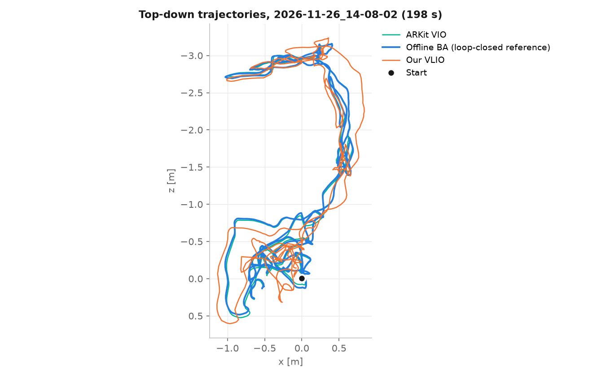
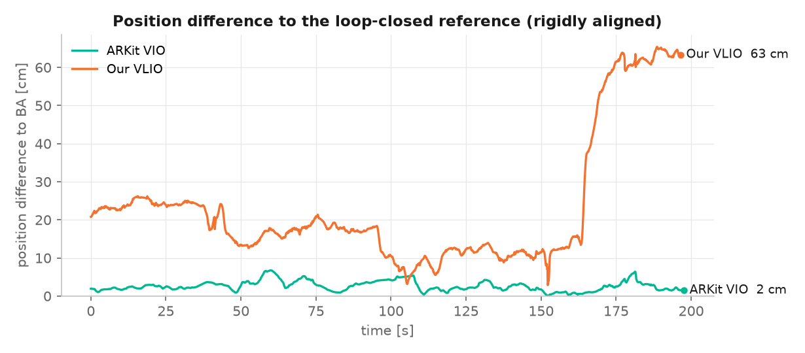
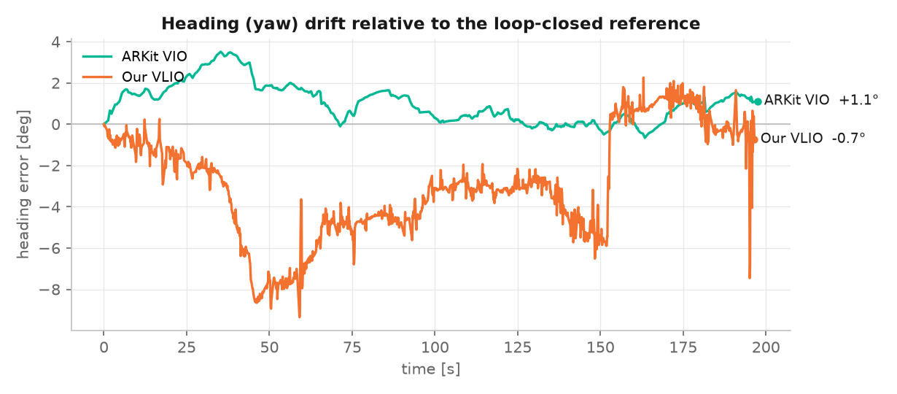
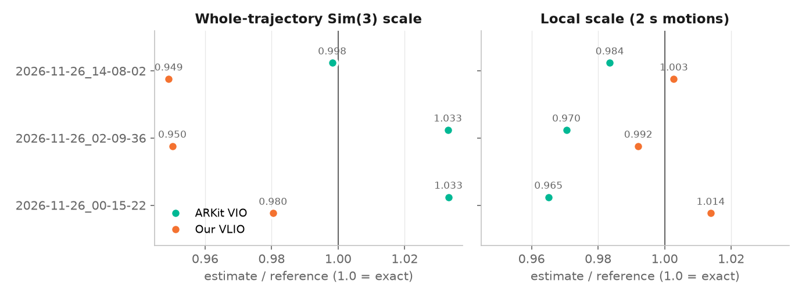
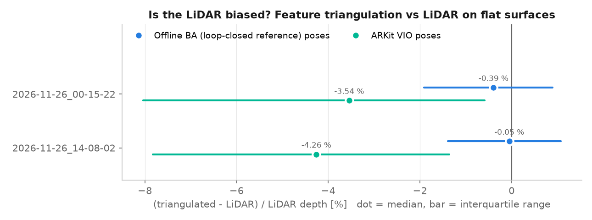
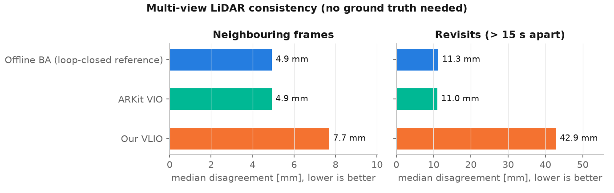
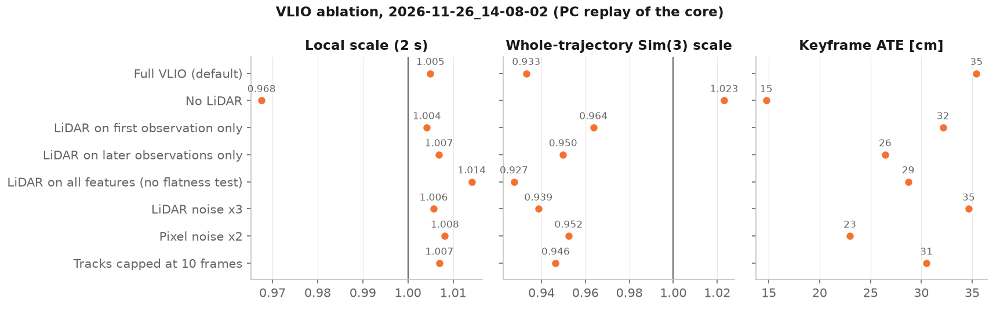

# Findings

All numbers and figures are produced by [`tools/make_figures.py`](../tools/make_figures.py)
(raw values in [`results/metrics.json`](results/metrics.json)). Recordings were made with an iPhone 15 Pro
in an apartment (rooms, hallway, kitchen). Recordings themselves are not published.

**Reference.** No external ground truth (motion capture) was available. The reference is an offline,
loop-closed bundle adjustment of each recording (`tools/run_ba.py`: SIFT features, sequential + loop
matches, reprojection + LiDAR depth + ARKit odometry + gravity, GTSAM). Two ground-truth-free checks are
used as well: *multi-view LiDAR consistency* (LiDAR of frame A reprojected into frame B vs B's LiDAR) and
*local scale* (length of 2 s motions vs the reference).

| Recording | Duration | Path | ARKit fps | Our VLIO computed by |
|---|---|---|---|---|
| 2026-11-26_00-15-22 | 85 s | 10.9 m | 60 | PC replay of the core |
| 2026-11-26_02-09-36 | 172 s | 20.8 m | 30 (throttled) | the phone (live preview build) |
| 2026-11-26_14-08-02 | 198 s | 33.9 m | 60 | the phone (post-scan processing) |

## 1. Capture quality

| | 2026-11-26_02-09-36 (old recorder) | 2026-11-26_14-08-02 (raw-only capture) |
|---|---|---|
| ARKit frame rate | 30 fps throughout | **60.0 fps** |
| Frames missed by the app | 51 % (+ a 4.8 s interruption) | **0** |
| RGB-D frames dropped | 45 | **0** |
| Thermal state | not logged (throttled) | **nominal** start to end |
| IMU vs ARKit | gravity 0.2°, gyro r = 0.810 (gaps) | gravity 0.1°, gyro r = **0.999**, offset 0 ms |

Moving all derived work (aligned depth, VLIO) to after the scan and removing per-frame allocations made
the capture clean. On-device processing of the 198 s scan then wrote aligned depth for all 1977 RGB-D
frames (matches raw LiDAR within 0.02 %) and the VLIO trajectory (941 keyframes, no restarts).

## 2. Trajectories

| 2026-11-26_14-08-02 | ATE vs BA | Sim(3) scale | Local scale (2 s) | LiDAR seq. (median) | LiDAR revisits (median) |
|---|---|---|---|---|---|
| ARKit VIO | **2.9 cm** | 0.998 | 0.984 | 4.9 mm | **11.0 mm** |
| Offline BA (reference) | 0 | 1 | 1 | 4.9 mm | 11.3 mm |
| Our VLIO, keyframes (phone) | 28.3 cm | 0.949 | **1.003** | 7.7 mm | 42.9 mm |
| Our VLIO, every frame (phone) | 29.0 cm | 0.952 | 1.012 | 7.4 mm | 43.7 mm |

ARKit is globally more accurate on this scan. Its 10-13 cm jumps at 178-182 s are relocalisation
corrections, which our core does not have yet.

## 3. Heading drift is the dominant VLIO error

Yaw is unobservable for any visual-inertial system without revisits. Our VLIO drifts by up to ~8°, which
at a few metres from the start explains its 15-60 cm position error. ARKit stays within ~3.5° because it
recognises places it has seen and corrects itself. **Next step: loop closure** (place recognition +
pose-graph / BA correction) in the shared core.

## 4. Scale: local vs whole-trajectory

| | Sim(3) scale (whole trajectory) | Local scale (2 s motions) |
|---|---|---|
| 2026-11-26_00-15-22, ARKit / VLIO | 1.033 / 0.980 | 0.965 / **1.014** |
| 2026-11-26_02-09-36, ARKit / VLIO | 1.033 / 0.950 | 0.970 / **0.992** |
| 2026-11-26_14-08-02, ARKit / VLIO | 0.998 / 0.949 | 0.984 / **1.003** |

A whole-trajectory similarity fit made our VLIO look 2-7 % too small. Measured on short motions, it is
within 0.3-1.4 % of the reference, more accurate than ARKit (1.6-3.5 % short). The apparent shrink is a
side effect of heading drift bending the path, not a metric error.

## 5. The LiDAR is not biased

Triangulating features (SIFT, flat surfaces, > 4° parallax) and comparing with the LiDAR depth at the same
pixel: with the loop-closed BA poses the two agree to **-0.05 %** and **-0.39 %** (interquartile range
about ±1.3 %). With ARKit poses, triangulated depth is 3.5-4.3 % short, i.e. ARKit's short-term
translations are slightly short, consistent with its local scale in section 4.

## 6. LiDAR depth consistency

Locally (neighbouring frames) our VLIO is 2.8 mm worse than ARKit/BA; across revisits the gap is the
drift of section 3.

## 7. Ablation of the VLIO core

PC replay of the core on 2026-11-26_14-08-02 (`tools/run_ablation.sh`):

| Variant | Local scale | Sim(3) scale | Keyframe ATE |
|---|---|---|---|
| Full VLIO (default) | **1.005** | 0.933 | 35.4 cm |
| No LiDAR | 0.968 | 1.023 | **14.8 cm** |
| LiDAR on first observation only | 1.004 | 0.964 | 32.1 cm |
| LiDAR on later observations only | 1.007 | 0.950 | 26.4 cm |
| LiDAR on all features (no flatness test) | 1.014 | 0.927 | 28.7 cm |
| LiDAR noise x3 | 1.006 | 0.939 | 34.7 cm |
| Pixel noise x2 | 1.008 | 0.952 | 23.0 cm |
| Tracks capped at 10 frames | 1.007 | 0.946 | 30.5 cm |

* LiDAR depth makes the local metric scale accurate (1.005 vs 0.968 without it).
* On this scan the run without LiDAR has a lower *global* ATE; on 2026-11-26_00-15-22 it is the other way
  round (5.0 cm with LiDAR vs 10.9 cm without). Global error is dominated by heading drift, which
  LiDAR does not constrain; the current weighting is not yet optimal for long scans.
* Hypotheses tested and **rejected** as causes of the global error: camera-IMU lever arm (grid over
  ±6 cm: ATE 4.3-5.0 cm, no trend), KLT feature drift (track-age caps), LiDAR noise level.
* The phone and the PC replay of the same core differ by ~15 cm (median) on the long scan: they decode
  images slightly differently, and the estimator is sensitive to it. Loop closure should remove this.

## 8. Synthetic ground truth (`core/tests/test_core.cpp`)

| Test | Result |
|---|---|
| IMU preintegration, 1 s at 200 Hz | 0.0000° rotation, 0.59 mm position error |
| VLIO, 12 s / 4.8 m, noisy IMU with biases, 0.7 px features, 1 cm + 1 % LiDAR | **9.4 mm RMSE**, 15.4 mm max, 0.32° max rotation |
| Gyro bias | (0.0043, -0.0030, 0.0022) vs true (0.0040, -0.0030, 0.0020) rad/s |

## 9. Performance

| | PC (one core) | iPhone 15 Pro |
|---|---|---|
| Front end per frame (480x360) | 8-9 ms | n/a |
| Back-end solve per keyframe | 21-28 ms mean | 132 ms mean (debug build, `.utility` QoS) |
| Post-scan processing, 198 s scan | n/a | 15.6 min before the release-build / QoS / vDSP fixes; re-measurement pending |

## 10. Loop closure (`core/src/loop_closure.cpp`)

Runs after the scan, over the whole recording:

1. every keyframe keeps ~500 ORB-style features (FAST on a 4-level pyramid, intensity-centroid
   orientation, 256-bit rotated binary descriptor) with the LiDAR depth at each corner (~25 KB per keyframe);
2. revisit candidates from the trajectory estimate (camera centres < 2 m, viewing directions < 45°,
   look-at points < 1.5 m, > 8 s apart), up to 4 per keyframe from different moments;
3. verification: appearance matching (Hamming, ratio + mutual) united with guided matching (LiDAR corners
   projected with the current estimate), 3-point RANSAC on LiDAR 3D-3D matches, a second guided round with
   the RANSAC pose, Gauss-Newton on two-sided reprojection error, >= 20 inliers within 3 px, and agreement
   with the trajectory within the drift expected for the time between visits;
4. 4-DoF pose graph (position + yaw per keyframe; roll and pitch are observable from gravity) with VLIO
   odometry edges and loop edges, sparse Cholesky, Cauchy kernel annealed from wide to narrow, inconsistent
   loops dropped; detect -> optimise is repeated 3 times so loops hidden by drift are found;
5. every frame is corrected by the keyframe corrections interpolated in time.

PC replay of the same code the phone runs (`core/tools/run_recording`), reference = offline BA:

| Recording | | ATE | Sim(3) scale | LiDAR consistency, revisits | loops accepted |
|---|---|---|---|---|---|
| 15-59-37 (249 s) | ARKit | **4.6 cm** | 1.013 | 31.4 mm | |
| | VLIO odometry | 10.5 cm | 0.968 | 54.2 mm | |
| | **VLIO + loop closure** | 4.9 cm | **0.997** | **9.9 mm** | 665 |
| 14-08-02 (198 s) | ARKit | **2.9 cm** | 0.998 | **11.0 mm** | |
| | VLIO odometry | 37.0 cm | 0.944 | 58.7 mm | |
| | **VLIO + loop closure** | 11.0 cm | 0.968 | 15.9 mm | 286 |
| 00-15-22 (85 s) | ARKit | 4.5 cm | 1.033 | 23.1 mm | |
| | VLIO odometry | 5.9 cm | 0.981 | 49.2 mm | |
| | **VLIO + loop closure** | **3.1 cm** | **0.991** | **14.9 mm** | 29 |

On the longest scan the revisited LiDAR surfaces now line up better than the offline BA reference itself
(9.9 vs 13.9 mm). The 198 s scan keeps 11 cm ATE: its odometry drifted ~95 cm before the start of the scan
was revisited, and one stretch (40-60 s, 5° heading error in the odometry) is only seen again ~2 min later.
Loop closure costs 2-13 s on one PC core per scan.

## Next steps

1. Re-measure on-device processing time (now including loop closure) on the phone.
2. Appearance-only place recognition (bag of words) for revisits after very large drift and across
   re-initialised map segments.
3. Per-frame pose refinement for non-keyframes; analytic Jacobians.
4. Android port of the core (no LiDAR on the target phone: ML depth instead).
